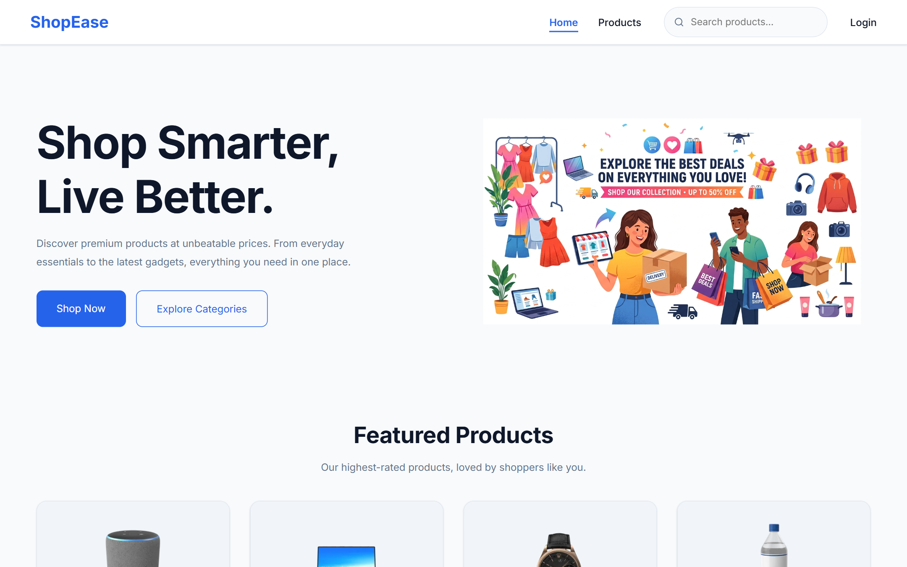

# ShopEase

A responsive e-commerce storefront built with **React 19**, **TypeScript**, **Redux Toolkit**, **RTK Query**, and **SCSS**. It covers the whole shopping flow: browsing and searching the catalog, cart and wishlist, checkout, order history, and account management.

> **Live demo:** _add link_ &nbsp;·&nbsp; **Repository:** [github.com/Shreyas262/ShopEase](https://github.com/Shreyas262/ShopEase)



---

## Highlights

- **Clear split between client and server state.** Redux slices own the auth, cart, and wishlist state. RTK Query owns product data, with caching, request deduplication, tag-based cache entries, and automatic refetching when the window regains focus or the network reconnects.
- **Custom persistence middleware.** A Redux middleware watches `auth/`, `cart/`, and `wishlist/` actions and saves the matching state to `localStorage`, stored per user. Each user's cart and wishlist are loaded back into the store when the app starts or when they log in.
- **The URL holds the catalog state.** Search text, category, sort order, and page number live in the URL's query string. Filtered views can be shared and bookmarked, and the browser's back button works as expected. The search bar in the navbar feeds into the same system.
- **Strict TypeScript throughout.** The app has shared domain types (`Product`, `CartItem`, `Order`, `Address`, `User`), typed store hooks, union types for payment method and order status, and generic `localStorage` helpers.
- **Polished UX.** Skeleton loaders appear while data loads, toast notifications confirm user actions, and every page handles empty and error states. Per-page SEO metadata is managed by a reusable `SEO` component. Layouts are mobile-first and responsive from 320px up to large desktops.
- **Modern tooling.** The project uses Vite with the React Compiler for automatic memoization, oxlint for linting, and SCSS partials loaded with `@use`.

## Features

| Area                | What's included                                                                                                                        |
| ------------------- | -------------------------------------------------------------------------------------------------------------------------------------- |
| **Catalog**         | Product listing, keyword search, category filter, price/rating sorting, and pagination                                                 |
| **Product details** | Image gallery with a modal viewer, specifications, and shipping info                                                                   |
| **Cart**            | Add, remove, and change quantities. Subtotal, shipping, and tax are calculated automatically, and shipping is free over $200           |
| **Wishlist**        | Save products for later and move them to the cart                                                                                      |
| **Checkout**        | Choose a saved address, pick a payment method (Card / UPI / Cash on Delivery), review the order summary, and see an order confirmation |
| **Orders**          | Order history and an order details page                                                                                                |
| **Account**         | Register and log in, protected routes, profile editing, address book, and password change                                              |
| **Landing page**    | Hero, category showcase, featured products, a "Why choose us" section, and a newsletter signup                                         |

## Tech Stack

| Category      | Tools                                                          |
| ------------- | -------------------------------------------------------------- |
| UI            | React 19, React Router 7, React Icons                          |
| Language      | TypeScript (strict mode)                                       |
| State         | Redux Toolkit, React Redux                                     |
| Data fetching | RTK Query                                                      |
| Styling       | SCSS (variables, partials, component-scoped styles)            |
| Notifications | React Toastify                                                 |
| Tooling       | Vite, React Compiler, oxlint                                   |
| Data          | [DummyJSON](https://dummyjson.com) product API, `localStorage` |

## Architecture

```text
React 19 + React Router
│
├── Redux Toolkit store
│   ├── Client state (slices)
│   │   ├── auth      → login, logout, updateUser
│   │   ├── cart      → add, remove, quantity, clear
│   │   └── wishlist  → add, remove
│   │
│   ├── Server state (RTK Query: shopApi)
│   │   ├── getProducts
│   │   └── getProduct
│   │
│   └── persistenceMiddleware → localStorage (stored per user)
│
├── Pages / components  (each component has its own SCSS file)
└── Utilities           (pure functions: order totals, formatting, storage)
```

**Data flow for the catalog:**

```text
Navbar search ─► URL query params ─► Products page ─► useGetProductsQuery()
                                         │                   │
                                         └── filter / sort / paginate (memoized)
```

## Project Structure

```text
src/
├── app-store/        # Redux store, slices, RTK Query API, middleware
├── components/       # Reusable UI, grouped by feature (checkout, product, profile…)
├── constants/        # SEO defaults
├── hooks/            # useSEO, useSearchParamUpdater
├── layouts/          # App shell (navbar, footer, outlet)
├── pages/            # Route-level pages
├── routes/           # Router config and ProtectedRoute
├── styles/           # Global SCSS: variables, reset, shared components
├── types/            # Domain types
└── utils/            # Pure helpers (order totals, storage, formatting, toasts)
```

## Notes

- **Authentication is a front-end demo only.** Users, orders, and addresses are stored in the browser's `localStorage`, so there is no real backend or security. Don't use real passwords.
- Product data comes from the public DummyJSON API.

## What I Learned

- Moving a working JavaScript codebase to strict TypeScript step by step, starting with the domain types and working outward
- Choosing which state belongs in Redux slices, which belongs in RTK Query, and which should stay local to a component
- Writing custom Redux middleware for side effects like persistence
- Keeping UI state in the URL so pages can be shared and the back button works
- Organizing SCSS at scale with partials, design tokens, and component-scoped stylesheets

## Author

**Shreyas Mahajan**: [GitHub](https://github.com/Shreyas262)
